# PENETRATION TESTING REPORT

### Week 2: Footprinting & Network Scanning Phases

**W2 | CYBERSECURITY | NETWORKWALKS**

| Field | Detail |
| --- | --- |
| **Pentester Name (Cybersecurity Professional)** | **[YOUR FULL NAME]** |
| **Program/Batch** | [YOUR BATCH, e.g. B0xx-Networkwalks] |
| **Date** | 12 November 2026 |
| **Modules completed** | W2-PM1 (Footprinting with Multiple Kali Tools)<br>W2-PM2 (Footprinting with GHDB)<br>W2-PM3 (Footprinting with Maltego)<br>W2-PM4 (Footprinting with theHarvester)<br>W2-PM5 (Network Scanning with Zenmap) |
| **Client/Target** | 1. Networkwalks (`networkwalks.com`, written permission secured)<br>2. `microsoft.com` (passive OSINT only, as assigned in the W2-PM4 lab guide)<br>3. My own local LAN network |
| **Permission secured from client?** | Yes |
| **Phases covered** | **Phase 1:** Reconnaissance & Footprinting<br>**Phase 2:** Scanning & Network Discovery<br>**Phase 3-5:** In Progress |

---

# 1. Liability Disclaimer

I have performed these activities only on systems and devices where I had secured written permission, or on devices and systems that I own myself, or in the lab scope set by the course. All materials here are for education and research purposes only. Do not use anything from here to break the law. The instructor, the author and Networkwalks are not responsible for what you do with this knowledge. Every action you take is your own responsibility. Misuse can lead to criminal charges, heavy fines, loss of your job and a permanent record. In most countries unauthorised access is a crime even when nothing is damaged.

---

# 2. Introduction

This report covers my Week 2 work in the Networkwalks Cybersecurity & Ethical Hacking internship. It follows the five Week 2 project modules:

| Module | Topic | Main activity |
| --- | --- | --- |
| W2-PM1 | Multiple Kali tools | Footprint `networkwalks.com` with whois, whatweb, nslookup, curl, wafw00f and dnsrecon |
| W2-PM2 | GHDB | Use Google dorks from the Google Hacking Database to find publicly exposed information |
| W2-PM3 | Maltego | Find email addresses linked to `networkwalks.com` |
| W2-PM4 | theHarvester | Collect emails, hosts and IPs for `microsoft.com` from public sources |
| W2-PM5 | Zenmap | Discover live hosts on my local network with a ping scan |

Together these show how an attacker moves from gathering public information, without touching the target, to mapping live hosts on a network. Every step lists the command or method used, what I observed, a screenshot as evidence, and why the finding matters from an attacker's point of view. Raw text outputs are saved in the `outputs/` folder.

---

# 3. Tools Used

| Tool | Purpose |
| --- | --- |
| Kali Linux & Windows | Operating systems used for reconnaissance and scanning |
| WHOIS | Domain registration details (registrar, dates, name servers, privacy) |
| whatweb | Fingerprint web technologies (server, CMS, plugins, IP) |
| nslookup | Resolve the domain name to an IP address using DNS |
| curl -I | Read the HTTP response headers of the website |
| wafw00f | Detect whether a Web Application Firewall (WAF) protects the site |
| dnsrecon | Enumerate DNS records (SOA, NS, MX, A, TXT/SPF, SRV) |
| Google + GHDB (exploit-db.com) | Ready-made Google dorks for finding exposed information |
| Maltego Graph 4.14.0 | Visual OSINT link analysis (domain to email addresses and pages) |
| theHarvester 4.11.1 | OSINT collection of emails, hosts and IPs from public sources |
| Zenmap (Nmap GUI) | Ping scan of a subnet to find live hosts |
| Windows CMD (`ipconfig`) | Identify local IP address, subnet and MAC address |

---

# 4. Activities Performed

## 4.1 W2-PM1: Footprinting with Multiple Kali Tools (`networkwalks.com`)

### Commands run

```bash
whois networkwalks.com
whatweb networkwalks.com
nslookup networkwalks.com
curl -I https://networkwalks.com
wafw00f networkwalks.com
dnsrecon -d networkwalks.com
```

### Task 1: WHOIS

WHOIS showed the domain is registered through **GoDaddy** and was created on **6 Nov 2019**, with expiry on **6 Nov 2027**. The registrant details are hidden behind a privacy service (**Domains By Proxy, LLC**), which keeps the owner's personal details out of public records. The domain also has all four lock statuses set (`clientTransferProhibited`, `clientUpdateProhibited`, `clientRenewProhibited`, `clientDeleteProhibited`), which protects against unauthorised transfer or modification. The name servers are `NS6135.HOSTGATOR.COM` and `NS6136.HOSTGATOR.COM`, with `NS29` and `NS30.DOMAINCONTROL.COM` also listed in the registrar record. **DNSSEC is unsigned.** The name servers point to HostGator, so an attacker immediately learns the hosting provider.

### Task 2: WhatWeb

WhatWeb confirmed the site runs on **Apache** with **WordPress 7.1.4** and the **WordPress Download Manager 3.3.76** plugin, plus jQuery 3.7.1 and Google Tag Manager. It also revealed the IP address **192.232.216.135**, a contact address (**info@networkwalks.com**), and a cookie `__wpdm_client` marked HttpOnly. The plain `http://` address returns a **301 redirect to HTTPS**, which is correct behaviour. An attacker can look up exposed versions in vulnerability databases.

### Task 3: nslookup

nslookup resolved `networkwalks.com` to **192.232.216.135**. The answer was non-authoritative, coming from my local router/resolver (`192.168.18.1`). Knowing the IP lets an attacker target the server directly and map related infrastructure.

### Task 4: curl -I

The response headers showed `HTTP/2 200`, `server: Apache`, `x-nginx-cache: WordPress` and `x-endurance-cache-level: 0` (pointing to the hosting platform's caching layer). The `link` header exposes the WordPress REST API endpoint **`/wp-json/`**. The cookie is set with `secure` and `HttpOnly` flags, which is good. In this output I did **not** see common hardening headers such as `Strict-Transport-Security`, `X-Frame-Options`, `X-Content-Type-Options` or `Content-Security-Policy`.

### Task 5: wafw00f

wafw00f reported that the site is **behind a ModSecurity (SpiderLabs) WAF**, using just 2 requests. Knowing a WAF is present shapes any later testing, because naive attempts would be blocked or logged.

### Task 6: DNSRecon

DNSRecon found **8 records**:

| Type | Result |
| --- | --- |
| SOA | `ns6135.hostgator.com` (50.87.144.87) |
| NS | `ns6136.hostgator.com` (192.232.216.131), `ns6135.hostgator.com` (50.87.144.87) |
| MX | `mail.networkwalks.com` (192.232.216.135) |
| A | `networkwalks.com` (192.232.216.135) |
| TXT (SPF) | `v=spf1 +a +mx +ip4:50.87.144.87 +include:websitewelcome.com ~all` |
| TXT | Google site verification token |
| SRV | `_autodiscover._tcp` pointing to `cpanelemaildiscovery.cpanel.net:443` (8 records) |

Both name servers answered a version query and disclosed their software as **BIND `9.16.23-RH`**. The DNSSEC query also returned no answer, matching the unsigned status seen in WHOIS. The mail server shares the same IP as the web server, which indicates shared hosting.

## 4.2 W2-PM2: Footprinting with GHDB

### Background

The Google Hacking Database (GHDB) on `exploit-db.com` is a collection of ready-made Google search queries called **dorks**. They use normal Google operators such as `intitle:`, `inurl:` and `intext:` to surface information that sites have accidentally left public. Because everything comes from Google's index, the target is never contacted directly.

### Method

1. Open `exploit-db.com` and go to **GHDB** in the left-hand menu.
2. Search the database (for example the term `cam`) and copy a dork.
3. Paste the dork into Google and review the results.
4. Record each finding with the exact dork used.

### Task 1: Publicly exposed cameras

<!-- REPLACE with your own results. Keep the table to 10 rows. -->

| No. | Link (mask the last part of the IP, e.g. `122.116.41.x`) | Relevant Dork | Username / Password (if any) |
| --- | --- | --- | --- |
| 1 | [FILL IN] | [FILL IN] | --- |

> **Ethics note:** I only recorded that a page was publicly reachable through Google. I did not log in, use default credentials, or control any device. Links to private devices are masked in this public report.

### Task 2: Downloadable mathematics ebooks (open directory listings)

<!-- REPLACE with your own results. Keep the table to 10 rows. -->

| No. | Link | Relevant Dork | Username / Password (if any) |
| --- | --- | --- | --- |
| 1 | [FILL IN] | `intitle:index.of "parent directory" mathematics pdf` | --- |

### Why this matters

Google constantly crawls and indexes whatever a site exposes. Dorks turn ordinary Google into a precise recon tool for exposed devices, open folders, backups and login portals. Defenders use the same dorks on their own domains to find and remove leaks before someone else does.

## 4.3 W2-PM3: Footprinting with Maltego

### Task 1: Install Maltego

Maltego Graph for Windows was downloaded from `maltego.com`, installed (including its Java 17 runtime prerequisite), and activated using a free Maltego ID with online activation, the default browser and Normal privacy mode. The version used was **Maltego Graph (Desktop) 4.14.0**.

### Task 2: Find email addresses for `networkwalks.com`

1. Added a **Domain** entity to the graph and renamed it `networkwalks.com`.
2. Right-clicked the entity, filtered for email transforms and ran **To Emails @domain [Search Engine]**.
3. The transform completed in about 35 seconds and returned **2 entities**: the email address **info@networkwalks.com** and a related web page (the student login/course page). The run consumed 10 credits and left 190.

Attackers use this kind of result to plan phishing and technology-specific attacks, for example against the WordPress site seen in W2-PM1.

## 4.4 W2-PM4: Footprinting with theHarvester

### Commands run

```bash
theHarvester -h
theHarvester -d microsoft.com -l 1000 -b baidu    # Task 1
theHarvester -d microsoft.com -l 50 -b all        # Task 2
```

`-d` sets the target domain, `-l` limits the number of results and `-b` selects the data source. `microsoft.com` is the target assigned in the W2-PM4 lab guide, and these runs used only passive public sources.

### Task 1: Baidu only

The Baidu run returned **no IPs, no emails, no people and no hosts**. The lab guide warns that results differ between runs because the sources keep changing, so a different result from the guide's example is expected.

### Task 2: All sources (`-b all`, limit 50)

Many sources failed with **"Missing API key"** errors because no keys were configured (for example BeVigil, Bitbucket, BuiltWith, Brave, Censys, Hunter, HaveIBeenPwned and SecurityScorecard). The sources that did work returned:

| Item | Count |
| --- | --- |
| ASNs | 6 |
| Interesting URLs | 3 |
| IP addresses | 155 |
| Email addresses | 3 (`dotnet-docker-bot@`, `opencode@` and `secure@` at microsoft.com) |
| People / LinkedIn users | 0 |
| Hosts / subdomains | 9,972 |

The very large host list shows how much of an organisation's infrastructure is discoverable from public sources alone, including development and test names. Because of its size, the full output is saved as a text file in `outputs/` instead of being pasted here.

## 4.5 W2-PM5: Network Scanning with Zenmap

### Lab tasks

| Task | Requirement | My result |
| --- | --- | --- |
| 1 | Download & install Zenmap on a Windows PC | Installed (Nmap 7.993 / Zenmap) |
| 2 | Find my local IP address and LAN subnet | [FILL IN from `ipconfig`] |
| 3 | Find the live hosts in my subnet | See below |
| 4 | How many hosts are live? | [FILL IN] |
| 5 | IP addresses of the live hosts | [FILL IN] |
| 6 | MAC addresses of the live hosts | [FILL IN] (use `ipconfig /all` for my own PC) |
| 7 | Save the topology as a PDF | [YES / NO] |

### First attempt: wrong subnet

```bash
nmap -sn 10.0.0.0/24      # Zenmap profile: "Ping scan"
```

The scan started at 21:01 (UTC+2) on 12 Nov 2026 and covered **256 IP addresses in 267.52 seconds. The result was 0 hosts up.**

**What this means:** zero hosts does not mean my network is empty. The lab guide says `10.0.0.0/24` is only the instructor's example and that each student must use their own subnet. My own router is at `192.168.18.1` (seen in the nslookup output), so my LAN is on a `192.168.x.x` range.

### Re-scan on my real subnet

<!-- REPLACE this section after re-running the scan with the subnet from ipconfig. Delete this comment when done. -->

| Item | Result |
| --- | --- |
| PC IP address & subnet mask (`ipconfig`) | [FILL IN] |
| Command | `nmap -sn [YOUR-SUBNET]/24` |
| Live hosts found | [FILL IN] |
| Host IP / MAC list | [FILL IN] |
| Topology PDF saved (Legend turned on) | [YES / NO] |

I also need to answer the questions on the Networkwalks Zenmap practice lab page after completing these tasks.

---

# 5. Risk Analysis / Impact

Based on the information collected during footprinting, I identified the following potential risks.

| # | Risk / Finding | Evidence / Observation | Potential Impact | Risk Level |
| --- | --- | --- | --- | --- |
| 1 | CMS and plugin versions exposed | WhatWeb showed WordPress 7.1.4 and Download Manager 3.3.76 | Attackers can check exposed versions against known vulnerabilities to decide what to test | **● Medium** |
| 2 | DNS server software version disclosed | DNSRecon returned BIND `9.16.23-RH` from both name servers | Reveals the DNS software and version, which helps targeted research | **● Medium** |
| 3 | Server IP and hosting identifiable | nslookup resolved to `192.232.216.135`; web and mail share the IP | Shows where the service lives and that it is on shared hosting | **● Low** |
| 4 | HTTP headers and REST API visible | curl exposed `/wp-json/`; no HSTS, X-Frame-Options, X-Content-Type-Options or CSP seen | Aids fingerprinting and leaves out some browser-side protections | **● Low** |
| 5 | WAF technology identifiable | wafw00f identified ModSecurity (SpiderLabs) | Reveals part of the security architecture | **● Low** |
| 6 | Public email address discoverable | Maltego and WhatWeb both exposed `info@networkwalks.com` | Can be used as a target for phishing or spam | **● Low** |
| 7 | Weak email/DNS hardening | SPF ends in `~all` (soft fail); DNSSEC unsigned | Makes email spoofing and DNS tampering somewhat easier | **● Low** |

**Risk level key:** ● Critical ● Medium ● Low

**Positive findings:** WHOIS privacy is enabled; all four domain lock statuses are set; HTTP redirects to HTTPS; cookies use `secure` and `HttpOnly`; and a WAF (ModSecurity) is in place.

These are observations from information gathering, **not confirmed vulnerabilities**. No exploitation or vulnerability validation was performed. Seeing a software version, IP address or DNS record does not by itself mean a system is vulnerable. Further authorised testing would be needed to confirm any real weakness.

---

# 6. Recommendations

1. **Limit exposed technology information.** Review what the website reveals about its CMS, plugins and versions, and remove version details where possible.
2. **Keep WordPress and plugins updated.** Apply updates promptly and check them against current security advisories.
3. **Restrict DNS version disclosure.** Configure the name servers not to reveal their BIND version.
4. **Add security headers.** Consider `Strict-Transport-Security`, `X-Frame-Options`, `X-Content-Type-Options` and a `Content-Security-Policy`.
5. **Review the REST API exposure.** Restrict `/wp-json/` endpoints that are not needed publicly.
6. **Tighten email and DNS settings.** Consider an SPF policy ending in `-all`, add DKIM and DMARC, and evaluate enabling DNSSEC.
7. **Keep the WAF enabled and tuned.** ModSecurity already blocks naive attacks, so keep its rules up to date.
8. **Reduce public email exposure.** Use contact forms or monitored aliases and train staff to spot phishing.
9. **Audit what search engines can see.** Run dorks against your own domain to find open directories, exposed devices and leaked documents, and remove or protect them.
10. **Run regular internal network discovery.** Scan your own networks periodically, verify every discovered device and keep topology documentation current.
11. **Test only with authorisation.** Reconnaissance and scanning must stay inside an agreed, written scope.

---

# 7. What I Learned

- **WHOIS** tells you who registered a domain, when, and which name servers it uses. Privacy services and domain locks are signs of good hygiene.
- **WhatWeb** and **curl -I** show how much a website says about itself (CMS, plugins, versions, hosting layers) without sending anything harmful.
- **nslookup** and **DNSRecon** turn a name into infrastructure: IPs, mail servers, SPF policy and name servers. Misconfigurations such as BIND version disclosure show up here.
- **wafw00f** matters because a WAF changes how later testing has to be done.
- **GHDB and Google dorks** show that a search engine can act as a recon tool. Defenders can use the same dorks to find their own leaks first.
- **Maltego** shows how one piece of public data (a domain) leads to the next (emails, pages) in a visual graph.
- **theHarvester** gathers emails, hosts and IPs from dozens of public sources. Results depend on API keys and change between runs, so it is best to try more than one source.
- **Ping scans** only show live hosts. A scan that returns "0 hosts up" often means the wrong target range, so the first step must always be confirming your own IP and subnet with `ipconfig`.
- **Good reporting** states what was done, what was found, what it means, what the risk is and how to reduce it, while clearly separating observations from confirmed vulnerabilities.
- **Authorisation comes first.** Even passive information gathering should stay within an agreed scope.

### Challenges and how I handled them

| Challenge | What I did |
| --- | --- |
| theHarvester returned "Missing API key" errors | Recognised that some sources need keys; documented which sources worked and saved the full output |
| Baidu source returned nothing | Noted the guide's warning that results vary, and compared with the `-b all` run |
| Zenmap returned 0 hosts | Realised the guide's `10.0.0.0/24` was only an example and planned a re-scan using the subnet from `ipconfig` |
| WHOIS output was long and split across screens | Captured it in five screenshots and summarised the key fields |

---

# 8. Conclusion

In Week 2 I completed practical work on footprinting and network scanning. For footprinting, I used WHOIS, WhatWeb, nslookup, curl, wafw00f and DNSRecon to build a profile of `networkwalks.com`: its registrar and hosting, its WordPress stack, its IP address, its WAF, and its DNS and email configuration. I also practised Google dorking with the GHDB, used Maltego to find a public email address, and used theHarvester to see how much of an organisation's infrastructure can be found from public sources alone. For scanning, I used Zenmap to run a ping scan and learned how important it is to scan the correct subnet.

The week showed me that a lot can be learned about a target before any exploitation takes place, simply by analysing public information carefully. It also showed me that findings must be documented clearly and honestly, and that every activity must stay inside an authorised scope. All of this work was completed as part of the assigned educational cybersecurity lab.

---

# 9. Evidence Collected

*Screenshots collected as evidence during the activities (stored in the `screenshots/` folder). Raw text output from theHarvester is in the `outputs/` folder.*

### W2-PM1: WHOIS
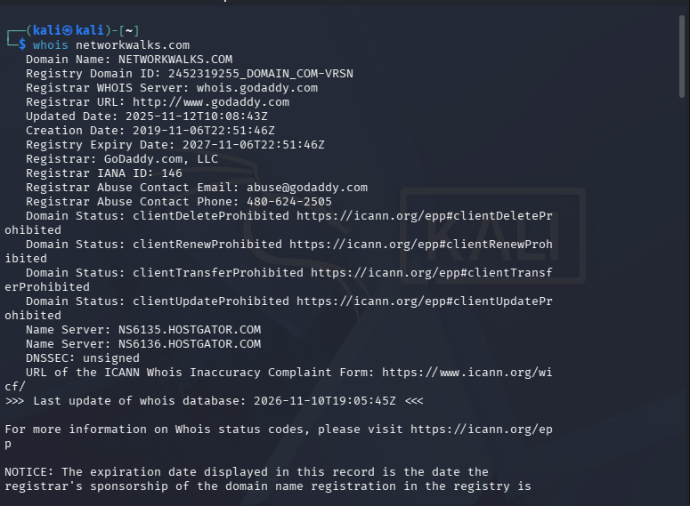
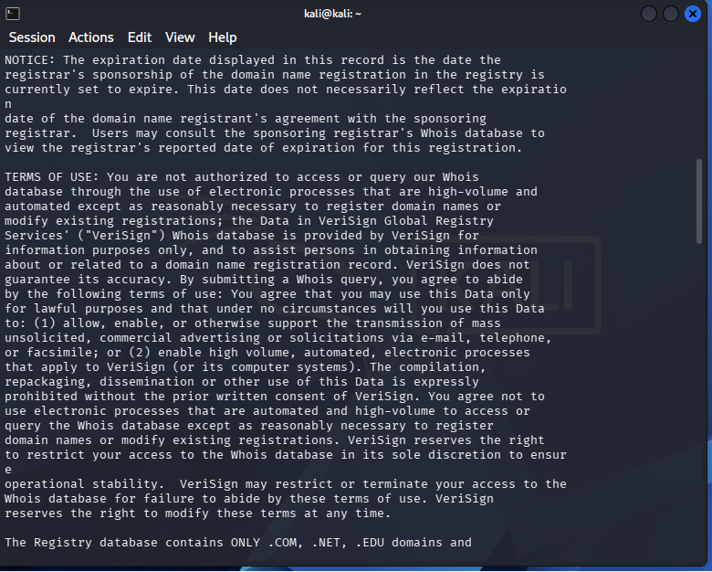
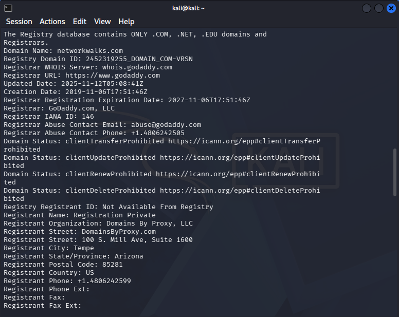
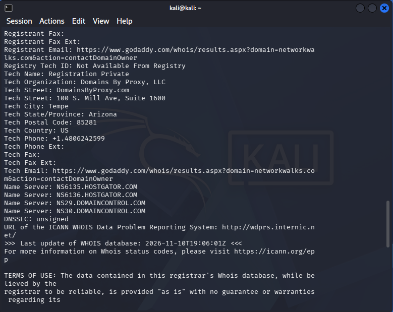
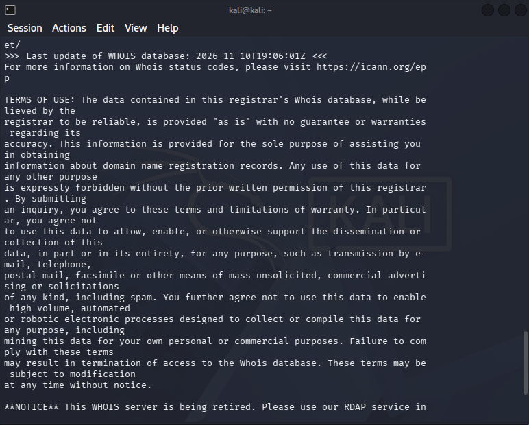

### W2-PM1: WhatWeb
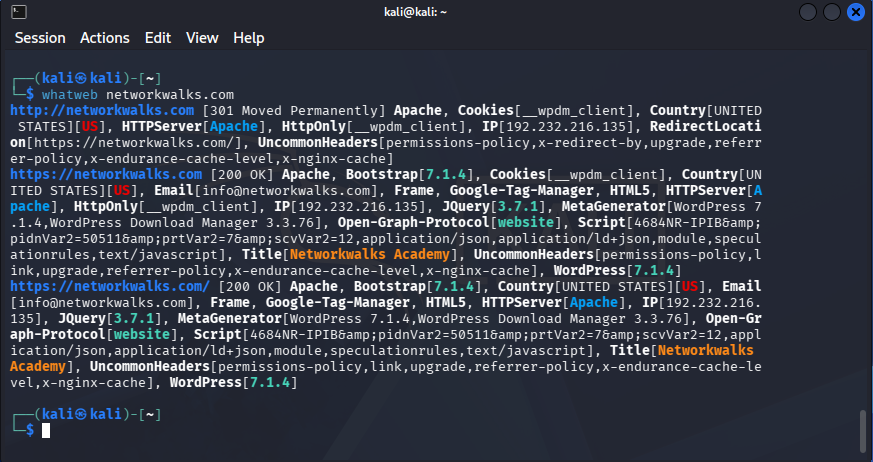

### W2-PM1: nslookup
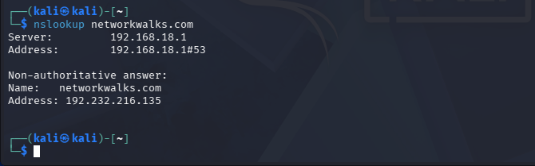

### W2-PM1: curl -I
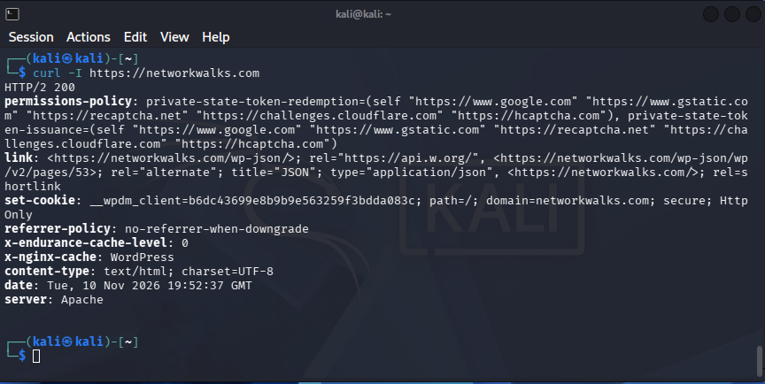

### W2-PM1: wafw00f
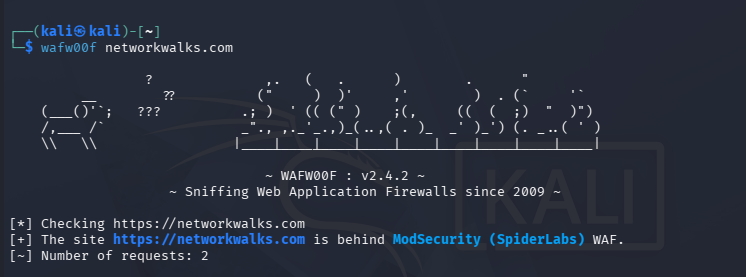

### W2-PM1: DNSRecon
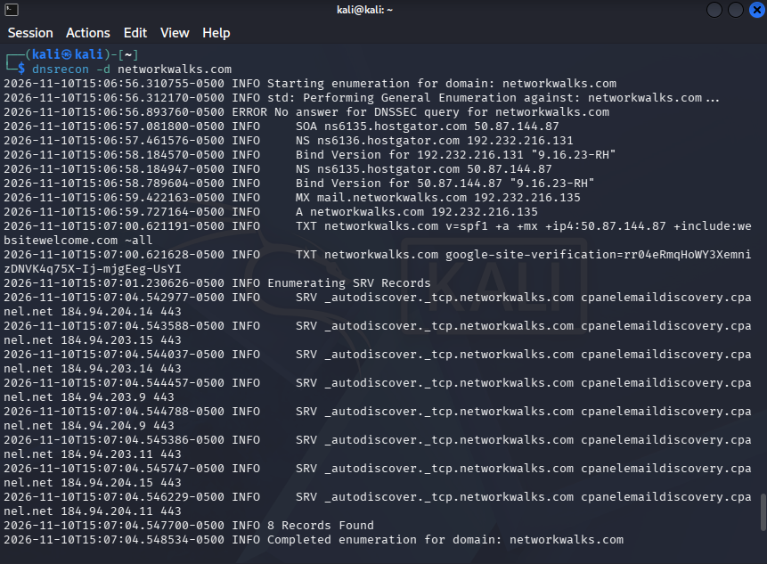

### W2-PM2: GHDB
<!-- Add your GHDB screenshots here, e.g. screenshots/17_ghdb_search.png -->

### W2-PM3: Maltego
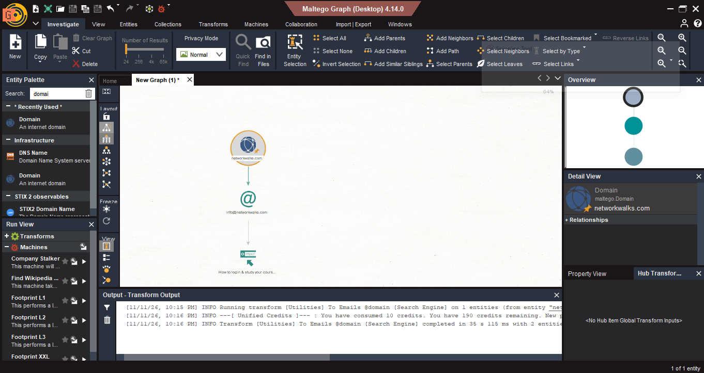

### W2-PM4: theHarvester
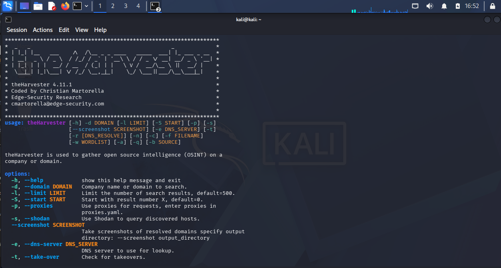
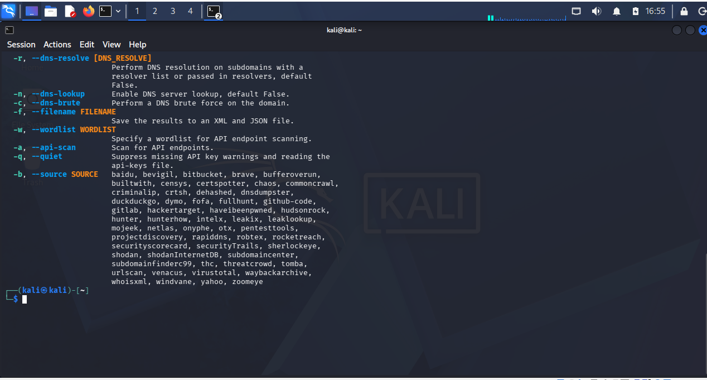
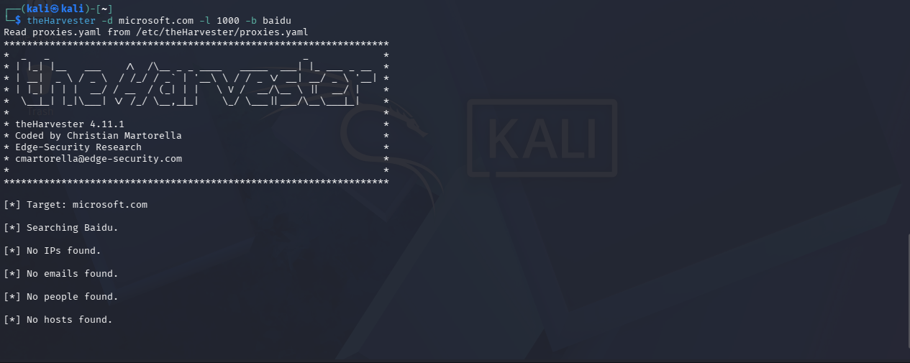
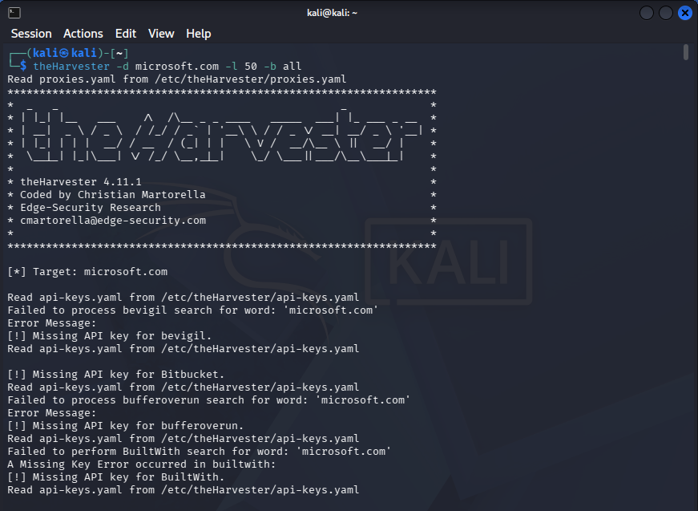

Raw output: [`outputs/theharvester_baidu_microsoft.txt`](outputs/theharvester_baidu_microsoft.txt) and [`outputs/theharvester_all_microsoft.txt`](outputs/theharvester_all_microsoft.txt)

### W2-PM5: Zenmap
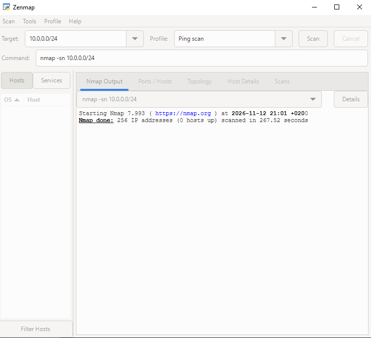

---

*End of report*
